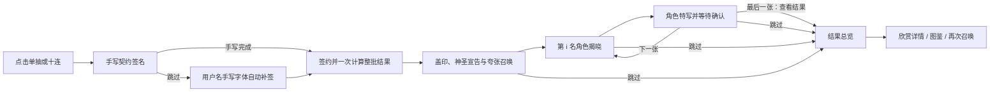

# C07 / F03：抽卡体验设计

**后续覆盖：** F03已交付。用户已选择F04高频水晶连击与透明冰法师首秀，最新分镜/点击语义见 [13_F04](13_F04_水晶连击与冰法师首秀.md)，任务见 [14_F04](14_F04_执行任务单.md)。本文件固定时间开场不再约束水晶等待，签署与逐张/跳过规则保留。

日期：2026-10-08。总指挥仅设计、计划和验收，不修改游戏实现或启动执行 agent。

用户已确认基础抽卡闭环验证通过。当前目标转为：一次召唤有期待、每名角色有特写、玩家决定欣赏多久、十连随时跳到结果，游戏界面清除全部开发状态和防御性说明。

同日新增与修正：用户要求BA参考的手写契约、神圣台词与极度夸张开场；签署页不设快速签署，点“跳过”自动用手写字体填用户名并继续。最新补充为 [11_C09_契约签署与夸张召唤.md](11_C09_契约签署与夸张召唤.md)，优先于本文件旧开场建议。

## 1. 推荐路线与评估

**下一版主线采用 2.5D：2D 角色 + 分层背景 + 星环/光效 + 可控镜头。先用现有素材实现交互；Blender 限定为可替换的通用开场候选。**

下表的投入等级是依据本项目已有资产与接入链作出的设计判断，不是实测工期或性能结论。

| 路线 | 表现优势 | 本项目追加工作 | 本轮判断 |
|---|---|---|---|
| 纯 2D / 2.5D 实时合成 | 角色风格一致，时间/停留/跳过容易调；现有图片可复用 | 星环、遮罩、动态曲线、音效；透明角色仍不齐 | 主线，最快改善玩家手感 |
| Blender 场景预渲染 + Unity 2D 揭晓 | 星环旋转、镜头穿越、透视和空间光照更有立体感 | 核对 Blender 执行链，制作与渲染短片，接入转场、视频裁切和跳过 | 最合适的 3D 增强方式，先做一个短样片 |
| Blender 建模 + Unity 实时 3D 场景 + 2D 角色 | 镜头、灯光、场景和停留均可交互，能长期扩展 | 模型导出、URP 材质/灯光校对、摄像机、粒子、角色平面融合与性能验证 | 后续路线，当前收益不如先做逐张确认 |

Blender 的 EEVEE 面向快速渲染和反馈，可用于场景样片；Unity VideoPlayer 支持向 Render Texture 输出视频。它们支持“短开场预渲染、角色和操作留在 Unity”的方案，但不足以证明本机已经具备该制作链。[Blender EEVEE 文档](https://developer.blender.org/docs/features/eevee/)、[Unity 2022.3 VideoPlayer 文档](https://docs.unity3d.com/2022.3/Documentation/Manual/class-VideoPlayer.html)。

本轮只确认项目现有 2D 素材与 `FastRevealView`；没有在 PATH/检查的常见目录确认 Blender 可执行文件，没有发现本项目的 `.blend`、模型场景或音频交付，也没有启动 Blender。**这不等于宣称本机未安装 Blender。** Blender 候选由执行者先核对实际版本、入口和渲染能力，未就绪时继续 2D 主线。

采用 2D 并不意味着只给图片加缩放。主要表现由共同开场、预兆的收束、角色揭晓瞬间、声音、信息进入顺序和最后的安静停留构成。AI 生成静态纹理和立绘；运动在 Unity 中控制，避免逐帧重新生成导致角色漂移。

## 2. 当前实现与本轮差异

当前 `PrototypeGame.Reveal()` 从整批中找最高稀有度，给该角色播放 0.9/1.8/2.6 秒的短动画，之后自动 `ShowSummary()`。这是已经验证的基本闭环，尚不是逐张演出。

当前 `FastRevealView` 可以消费已计算角色/Sprite，做预兆、剪影、全图、身份和光效清理。Main 已绑定六卡、主题和 `useFixedMock=false`。P02 的 2026-10-08 11:31:44 Play 报告通过，用户本轮也确认基本闭环通过。本轮不重复搭建框架，不将旧“自动完成”指标继续作为新版本通过标准。

## 3. 玩家流程（本轮冻结）

借鉴用户提出的BA签名参考与原神揭晓节奏，采用“手写/跳过补签、契约成立、神圣宣告与夸张召唤、逐名展示、确认推进、总览回看”。签署前尚未抽取，签约完成后一次计算整批。

- 点击召唤先进入契约页；手写或跳过自动补签完成后，只计算一次结果、扣一次资源、登记一次收藏。签署页返回不扣费。十连严格消费原批次顺序，第 i 张的图像/名字/等级/NEW 来自同一 `PrototypePull`；不只展示最高卡，也不按等级重排。总览保留同一顺序。
- 通用开场十连只播一次。预兆可使用本批最高等级的色彩/形态，**不开场就展示该角色身份**。下一张只是短转场，不重播完整开场。
- 每张卡均进入大图特写，完成揭晓后停留，**没有自动前进倒计时**。重复卡可以更快完成动画，仍须用户确认前进。
- 动画中单击/空格/Enter：快速完成当前阶段并进入当前卡停留，不消耗下一张。停留时的新一次输入才推进；长按不连续翻页，不把动画中的输入排队到下一张。
- 停留时显示“下一张”，第十张显示“查看结果”。单抽同样先停留，再“查看结果”；不因只有一张而强制跳过欣赏。
- 签署页的“跳过”只自动填入用户名手写字体，之后继续盖印、宣告和召唤，不直达结果；不设额外快速签署按钮。签署页Esc为返回。签约后的开场、动画与停留中点击跳过/Esc才进入完整结果总览，不增加“是否确定跳过”弹窗，不把未揭晓角色当未获得。
- 演出页仅留右上“跳过”、角落 `i/10`（单抽 `1/1`）、停留时的“下一张/查看结果”。点击画面可继续，按钮承担明确提示。开场时不伪装成已揭晓第1张，计数可先隐藏。
- 召唤页和结果页拥有下一次召唤入口；演出和停留中没有补充/再次召唤按钮。总览可点任一卡牌看详情，也可直接继续抽。

程序只需一个轻量流程：`Signing → Commit → Ceremony/Intro → Revealing → AwaitingConfirm → Revealing… → Summary`，继续沿用协程/现有模型即可，不引入状态机框架。Signing跳过与演出跳过是不同指令；补签后不再等待确认。等待角色确认时低强度环境光和粒子可继续，角色/信息已稳定；暂停的是推进，不是整个画面。

## 4. 视觉主题：星环召唤台

用一个原创通用舞台衔接当前 RPG 画风：深蓝星空或压暗冰城，黄铜星盘与分离的两到三层环，中央晶核、少量碎光；画面中心留给角色。保留清楚线稿、赛璐璐阴影和克制高光。

层次：背景 → 外环/内环 → 少量背光 → 人物或完整卡图 → 前景碎光 → 身份与操作。默认光效在人物后，脸前不堆粒子。

揭晓时隐藏常规导航、资源条和其他页面文字。1920×1080 起点：角色主体占约 65%—80% 高度，脸在上半部，姓名/等级位于人物侧方或下方，操作留在角落。720p 和 16:10 再调裁切，角色保持比例。

**特写优先让角色读得清楚。** 透明冰法师可作全屏构图；其余角色目前是完整背景卡图，用大图/遮罩展示，不做虚假的人物分层。UR 火女战士透明层是优先素材补项，可先用现有完整卡图验证同一流程。未有美术的六条 ID 使用统一剪影和真实名字/等级，移除“角色立绘占位”文字，不用一张已知角色图假充其他身份。

## 5. 动画分镜与时长

以下为制作起点、不是已实测手感。时长均指主动动画，**不包含玩家自由停留**。普通卡短，高级卡多一个节奏层次；首次高级卡可略延长，重复卡不强制观看长片。

### 5.1 契约与共用开场：约 5—7 秒（用户新增夸张方向）

| 时间 | 画面 | 声音 / 操作 |
|---|---|---|
| 0.00—0.45 | 已完成签名变成金光 | “以此真名”与笔锋尾音 |
| 0.45—1.15 | 巨大星印砸下，印纹冲击展开 | “缔结星约”与重击 |
| 1.15—2.50 | 契约升空，天穹巨环出现 | “让群星回应”，合唱进入 |
| 2.50—4.20 | 星环咬合、晶体列阵、光柱与镜头穿越 | “让命运见证”，蓄力加强 |
| 4.20—5.00 | 短收束，光回吸，星门裂开 | 短停顿制造悬念 |
| 5.00—6.60 | “星门，为您而开！”与星门爆开同拍，光幕接第1张 | 旁白/钟鼓落点后让位于角色揭晓 |

签名自由输入时长不计入开场。普通等级也可经历同样夸张的签约仪式，最终信号与单卡演出再分档。2D用分层移动、旋转/缩放/遮罩实现，Blender可增强巨环与空间穿越；动态签名/用户名仍在Unity。完整分镜、旁白草案与补签行为见11；原2.2秒克制开场不再是本轮主方案。

### 5.2 单卡分档

| 等级 | 起点时长 | 动作与节奏 | 完成后的状态 |
|---|---:|---|---|
| R | 0.6—0.8 秒 | 细蓝光一闪，卡图快速显露，清亮短音，姓名简洁进入 | 大图停留；下一张 |
| SR | 0.9—1.2 秒 | 紫色环有一次聚拢，元素纹样先露，轮廓揭开，短和声音 | 大图停留；下一张 |
| SSR | 1.8—2.4 秒 | 背景压暗/蓄力，剪影，金色冲击，人物推近后轻回落，身份依次进入 | 光效退到背后；可长时间欣赏 |
| UR | 2.8—3.5 秒 | 环境音收束，双环重构，专属金红纹样，短停顿后强揭晓，火战士特写 | 环境恢复，余光克制；可长时间欣赏 |

SSR 的 2.2 秒样板：0—0.35 秒压暗与蓄力；0.35—0.70 秒剪影；0.70—0.90 秒冲击；0.90—1.45 秒人物由略放大回落到稳定构图；1.45—1.90 秒等级、名字、称号/NEW 依次出现；1.90—2.20 秒光效衰减，确认操作出现。

UR 的 3.2 秒样板：0—0.45 秒声场收束；0.45—1.10 秒双环重构；1.10—1.50 秒剪影与金红裂纹；1.50—1.70 秒揭晓重击；1.70—2.55 秒角色特写；2.55—3.00 秒身份/NEW；3.00—3.20 秒收束后等待确认。

高级差异必须同时来自运动形态、声音和构图，不只将蓝色换成金色。UR 的专属金红来自当前火女战士，后续角色主题改变时配置随之更换。角色图保持身份，整图只有轻微移动/缩放，不声称未拆分立绘可以摆动手脚或眨眼。

下一张过渡约 0.12—0.20 秒：当前身份淡出，光幕横过，下一张进入；不重复契约与长开场。开场按用户要求尽量豪华，角色出现后的冲击避免长时间盖住脸。进入停留后关闭强震动和强闪光，操作区域位置固定。

### 5.3 声音是必要的体验层

最低需求：笔锋/巨印、签约神圣旁白、开场蓄力/合唱/爆发、普通揭晓、高级揭晓、UR 收束/冲击、确认下一张、跳过。R/SR 可共用音源调整音高；SSR/UR 的响度与低频应区分，而非不断提高总音量。本轮新增单段仪式旁白，不扩充逐角色配音。

当前没有确认可用音频；可先用程序生成的原创合成提示音/短和弦验证节奏，再替换成更好的音效。记录来源与实际试听，不将缺音或合成音写成正式音效已验收。音效和画面在揭晓瞬间对齐，跳过时蓄力尾音迅速淡出。

## 6. Blender 候选的明确边界

候选先只做 **一个通用召唤舞台、一个约5—7秒豪华仪式的空间段样片**，按11的最新分镜。签名/用户名留Unity，不建角色、不建城堡大场景、不做每张角色视频。

场景由圆台、两到三层星环、六到八块漂浮晶体、中央发光核和暗色远景构成。用基础几何、少量倒角、低饱和色块与发光形状；镜头从轻俯视推进到晶核，最后与 Unity 的光幕转场接上。三帧评审点：静止建立、星环锁定、穿越前一刻。

交付 `.blend` 母版、可复跑场景脚本（如使用）、三帧构图图、短片和实际渲染参数。先以 720p 样片比较构图和衔接，通过再出 1080p。为 16:10 保留中心主体和外圈安全区，不把按钮或名字烘焙进视频。开场直接播放，不需要透明视频；UI 叠在 Unity 中。

预渲染视频只负责开场，VideoPlayer + Render Texture 接入；不让视频播放器承担十张卡的停留/输入，也不把十连结果写进视频。播放前准备好短片以验证无黑帧，点击跳过立即停止并转总览。将来若选择实时3D，另开任务验证模型、URP 材质和镜头，不要求两条链同批都做。

选择标准：相同豪华仪式分镜下，天穹巨环、镜头穿越和空间尺度是否明显改善、是否衔接自然、跳过是否即时、与现有角色画法是否一致。用户要求是更夸张的整体体验；不因用了3D就自动判为更好。

## 7. 游戏文案纯净化（下个版本强制）

所有开发状态、免责声明、限制解释和调试提示从玩家界面移走。相关信息可以保留在交接文档、Console 和 Editor 工具中，不搬到游戏内“高级设置”。

| 当前文字/入口 | 下版处理 |
|---|---|
| “保底 / 共鸣 / 新手赠礼：尚未接入”“基础随机 · 保底与共鸣尚未接入” | 删除整行，释放画面空间 |
| “当前原型 · 基础随机”“UI MOCK / 固定数据”“正式运行请关闭 Use Fixed Mock” | 玩家入口不显示，固定 mock/预览工具留 Editor |
| “收藏仅保留在本次运行，退出后重置”“本次运行内收藏”“本轮收藏” | 删除说明；标题用“图鉴”，实际数量正常显示 |
| “共鸣 / 桌面展示：尚未接入” | 删除；没有完成的功能入口隐藏 |
| “角色立绘占位”“高级预览 · 不消耗资源 / 不计入收藏” | 前者换统一剪影无开发字样；后者移出玩家界面 |
| 详情中的稳定 ID，如 SSR001；校准说明；测试结果文字 | 不出现在玩家页面，ID 与校准仍保留给开发者 |
| “资源不足，点击右上角免费补充 +10。” | 不弹解释文字；显示当前资源/消耗，资源不够时召唤按钮变暗，保留明确 +10 入口 |
| 规则弹层里未实现功能与预览免责声明 | 只留下实际运行规则：R/SR/SSR/UR 70/24/5/1、同级等概率、消耗1/10、补充+10 |

保留玩家需要的信息：概率、资源、消耗、姓名/等级、NEW、未收录、拥有数量、跳过、下一张、查看结果、返回和隐藏界面。“未收录”表达真实图鉴状态，可以保留；不要因此新增声称已实现的保底数字、永久保存或共鸣功能。

检查范围包括 HasArt 和旧主题分支、规则弹层、单抽/十连、详情、图鉴、资源不足和隐藏/恢复。不能只改主页可见的两行文字。

命名按用户最新确认：《这次一定出》是外层游戏名，《星界回响》是内层抽卡游戏名。内层全部页面、契约、台词、字幕、徽记与召唤动画不得出现外层游戏名，连改标点的标题呼应也删除。C06/08的旧标题指令已更正；当前PrototypeGame中两个页头仍使用外层名，U03-CLEAN须替换为内层名并实际逐页查看。项目文件路径和Editor菜单不是内层玩家文案，无需更名。

## 8. 最小交付与验收

下一批要求：手写契约、跳过用户名自动补签、神圣旁白与夸张开场、逐张揭晓与确认、分阶段跳过、四档节奏、SSR/UR大图、全界面文案清理及Main集成。保底/存档/升格/共鸣/桌面叙事继续另排，不为本批扩大框架。

顺序和 agent 提示词见 [10_F03_执行任务单.md](10_F03_执行任务单.md)。首个任务是 P03-REVEAL，用现有美术先验证新交互；其后清理 UI、补最少素材，再做视听整合。Blender 候选不作为主线前置。

验收关注实际体验：十张都能逐张看到、停留不自动推进、最后一张也需确认、跳过得到同一批十张、重复卡 NEW 正确；阶段点击和 Esc 合理；单抽逻辑一致；人物大且清楚，SSR/UR 有明显节奏差异，声音与冲击同步，最终页面没有开发/防御性说明。执行者提供新的 Play 记录和片段，旧 P02 自动完成报告只能证明上一版。

## 9. 学习点与调参

协程控制节奏，输入控制推进，展示只消费结果；Sprite/Mask/CanvasGroup 控制图像和退场；曲线决定蓄力/冲击/回落；AudioSource 配合关键时刻发声。先调确认逻辑，再调 R/SR 时长，接着调高级预兆与人物大小，最后调粒子、音效和开场。时间与强度暴露在 Inspector/演出配置，不需要改抽卡规则。
