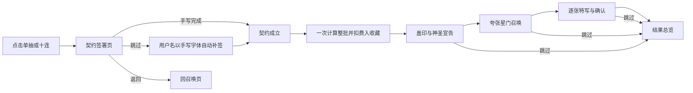

# C09：契约签署与夸张召唤

**F04后续覆盖：** 用户已选择 [高频水晶连击与透明冰法师首秀](13_F04_水晶连击与冰法师首秀.md)。前奏接主动蓄能与破裂白光，等待不计入固定时长，最后一句按破裂终结调度；本文件签署/补签、用户名、定稿旁白、品牌和逐张确认约定继续有效。当前任务见 [14_F04](14_F04_执行任务单.md)。

日期：2026-10-08。总指挥只设计、计划和验收，本轮不修改游戏实现、不生成素材、不启动执行 agent。

用户补充：参考 BA 的签名仪式，召唤前手写签名订立契约，配合神圣台词和极度华丽、夸张的召唤动画。随后明确：**不设置“快速签署”按钮；签署页点击“跳过”，用手写字体自动填入用户名，然后继续契约与召唤。**

本文件覆盖09/10中有关召唤入口、通用开场和“所有阶段跳过直达结果”的旧约定；逐张揭晓、每张确认、最后确认与游戏文案清理继续保留。这里以用户给出的 BA 参考行为为设计输入，不声称复刻了 BA 全部实际交互。

用户最新命名约束：《这次一定出》是外层游戏名，内层抽卡游戏沿用《星界回响》。内层界面、契约、旁白、字幕、徽记、动画及结果页均不得出现外层游戏名，也不得将它改标点后作为宣告引用。

## 1. 完整流程与两个阶段的跳过

| 当前页面/阶段 | 点击右上“跳过” | 是否直接进总览 |
|---|---|---|
| 契约签署页 | 手写字体填入当前游戏用户名，短暂显露签名，完成签约并继续盖印/宣告/召唤 | 否 |
| 契约已成立后的盖印、宣告、星门开场 | 停止剩余演出，展示已计算的完整结果 | 是 |
| 单卡动画或角色停留 | 展示同一批完整结果 | 是 |

界面上按钮都叫“跳过”，行为由阶段决定。**没有额外快速签署按钮、免签入口或默认跳过签约设置。** 签署页跳过不等于跳过召唤，不增加“已自动代签”提示弹窗，自动补签后不再等待第二次确认。

点击单抽/十连先打开契约页，只记住请求数量，此时不计算结果或扣费。手写/自动补签完成后统一触发一次签约提交、Draw、扣费和收藏更新；之后所有演出只消费这份结果。签署方式、笔迹形状、字数和耗时不参与概率，不做OCR、签名鉴别或评分，也不在游戏里放“签名不影响概率”的免责声明。

签署页返回箭头/Esc回召唤页，不扣资源；进入盖印/宣告后Esc才等同跳过演出到总览。舞台切换时同一次“跳过签名”的点击不穿透成下一阶段跳过。这里是操作语义，不扩展存档/事务框架。

## 2. 手写与自动补签

### 手写

契约中央下方留签名区，用户按住鼠标写一笔连续签名或符号，松开后接受并进入契约成立。任意笔迹均可；不要求写出完整昵称、不评判好坏、不用识别失败提示。文字只需“在此签名”，不增加长教程或确认弹窗。

字迹是可见的指针轨迹，普通墨色保证可读；成立时金色沿轨迹亮起，最后一笔化成上升金线。程序用现有uGUI绘制轨迹并在签名区内展示，不依赖新输入框架。

### 跳过后的补签

右上角“跳过”调用同一提交路径，使用**当前游戏用户名**生成手写字体的文本。建议用约0.3—0.5秒横向显露墨迹，让玩家看到名字已签上，然后直接盖印。不要把“自动补签完成”作为新的停留点，也不要再要求点击“确认签署”。

用户名来源统一为 `playerDisplayName` 一类游戏显示字段。当前源码未找到已有昵称来源，本轮可先增加一个可在Inspector设置的显示昵称，默认“召唤者”，以后昵称入口也读取同一字段；不为此新增账号/登录系统。用户配置自己的名字后，自动补签必须显示该名字，不能每次都写默认值。

当前未找到工程内手写字体交付。UI agent确认实际可用的字体、中文/英文昵称字形与显示效果后导入；自动签名使用真正的手写风格字体，文字作为UI单独渲染，不让ComfyUI生成动态用户名。字体来源与许可记录在开发交接，不显示在游戏契约上。

手写与补签只改变纸上的图像表现，共用后续盖印、神圣台词和抽卡路径。签名无需本轮持久化，也不自动复用上次手写签名替代用户这次操作。

## 3. 契约画面与原创台词

契约像一份过于郑重的神圣文书：象牙白纸/半透明石板、细黄铜线、暗蓝底，顶部星界徽记，下部签名区与一个尚未盖下的巨大星印。纸、花纹、签名、印章、台词分别分层；美术稿无烘焙中文。

暂定契约文案：

> 群星召唤契约
>
> 愿以此名，唤醒沉睡于群星之间的回响。
>
> 此约既成，群星为证。

可以在纸底用一句叙事小字：“本次为最后一次十连。”它是原案讽刺基调的世界内笑点，不是免责条款，不阻塞签名。

**神圣旁白（用户定稿）：**

> 以此真名，缔结星约。
> 让群星回应，让命运见证——
> 星门，为您而开！

表演方向：认真、庄严、逐步增强，最后一句与星门爆开同拍；低声或空灵声线均可，配少量合唱/钟声/低鼓。台词讲得越郑重，普通结果越容易产生项目需要的反差。角色本身仍好看，不用丑化普通卡、嘲笑玩家或强制插入冷笑话弹窗。

宣告属于《星界回响》的星门契约设定，不引用外层游戏名，不新增必出机制。游戏内概率页依然显示实际概率，不在宣告后补一行防御性注释。

## 4. 夸张开场分镜：约5—7秒

签名输入时长不计入开场。下面时长是设计起点，需配合实际旁白节奏调整，最终以试听与Play片段验收。

| 时间 | 画面 | 声音与台词 |
|---|---|---|
| 0.00—0.45 | 签名被金光重描，纸上字迹像获得生命 | 笔锋尾音、低钟一响；“以此真名” |
| 0.45—1.15 | 巨大星印从上方砸下，印纹与金色冲击波展开 | 重击、短震动；“缔结星约” |
| 1.15—2.50 | 契约升空，签名化作金线，天穹出现巨型星环 | 合唱进入；“让群星回应” |
| 2.50—4.20 | 多层星环咬合，晶体列阵，光柱直冲画面深处；镜头穿过外环 | 弦乐/合成扫音加速；“让命运见证” |
| 4.20—5.00 | 极短收束，所有光向中心回吸，星门裂开 | 音乐短暂停顿；拖出破折号的悬念 |
| 5.00—6.20 | “星门，为您而开！”与星门爆开同拍，碎光/纹样/镜头推进形成高潮 | 旁白、钟/鼓/合唱一起落点 |
| 6.20—6.60 | 光幕收束，进入第1张角色 | 尾音让位于揭晓音，姓名画面清楚 |

“闹麻”主要来自**过度庄严的签约、巨印重量感、越来越大的场景尺度、声音叠层与最终爆发**。可以让全部等级都经历夸张的契约仪式；最终星门信号再按最高等级分色，R仍用短揭晓，SSR/UR接专属冲击。十连只播这一套仪式一次，不每张重签或每张重播长开场。

角色出现前允许画面规模拉满；角色出现后强光迅速退出脸部区域，停留画面干净，保留此前“逐张确认”的规则。跳过始终在固定位置，不被光效遮挡。

## 5. 2D与Blender在这套设计里的用途

2D/2.5D仍能做完整流程：契约/轨迹/文字用uGUI，巨印与环纹用独立透明图，升空/推进通过分层缩放和遮罩，光柱/冲击/碎光用Unity控制。先有一个能手写、能补签、能逐张确认的版本，不等待整段成片。

Blender候选从旧2.2秒短开场改为**约5—7秒夸张仪式中的通用空间段**。最适合增强“契约升空、天穹巨环、晶体列阵、穿越星门”的深度；纸上的实际签名、用户名、UI、结果和人物保留在Unity。不要把某个用户名烘焙进预渲染视频，也不要为每个用户重渲染短片。

候选先做一个相同分镜的720p金色样片与建立/巨环/爆开三帧，实际Blender链确认后才生产。整段预渲染无需签名透明层视频，姓名由Unity前段展示；可把印章特写接到通用片段，再由光幕接人物。若样片没有明显提升，2D版本仍需按相同豪华分镜完成。

旁白是本轮新增的单段叙事音轨，不扩充十二名角色配音。执行者先确认实际可用的配音/TTS/音频能力，记录来源与试听；没有实际语音就列缺项，不把字幕加合成提示音宣称为已完成神圣旁白。功能路线可先运行，视听验收保持待验收直到有可试听交付。

## 6. 同步执行任务

不另起账号系统或大框架，修订现有F03任务：

- **P03-REVEAL**：先搭“签署 → 统一签约提交/计算 → 仪式 → 逐张确认”的状态流程；记录一笔轨迹；补签读取唯一用户名；根据阶段处理跳过。用现有/简易素材验证即可。跨UI范围补充交接：签署字段/页、召唤入口提交时点、签名输入与返回，接着仍是原揭晓区域。
- **U03-CLEAN**：契约签名区、手写字体、补签文字、安全区和分阶段按钮；只保留“跳过”，不新增快速签署；原纯净界面清理继续实施。
- **A05-REVEAL**：补契约纸/纹样、无文字星印、巨环/光柱/冲击等最少可复用层；动态图和用户名不烘焙。现有角色与星芒继续使用。
- **P04-FEEL**：5—7秒神圣旁白与夸张分镜整合、视听同步、Main接入；若有通过评审的Blender空间段才接入，不将签名或暂停操作交给视频。
- **A05-BLENDER**：通用空间段候选，按本轮豪华分镜制作；用户名/手写不入视频，不改结果流程。

验收新增：手写和跳过补签都能进同一后续流程；补签显示配置用户名和手写字体；签署页跳过不直接总览；补签后无需再确认；签署返回不扣资源；签约只计算/扣费一次；后续跳过仍保留整批；无快速签署按钮；签名不改变概率；台词与星门高潮同步，逐张欣赏仍清楚。

命名验收：内层全部页面、契约、美术文字、旁白与字幕只使用《星界回响》及其世界观文案；无外层游戏名的标点变体或标题呼应句。项目目录、Editor菜单和开发交接仍可保留项目名。

## 7. 学习点与状态

UI指针轨迹与文本是两种签名表现；同一提交入口保持行为一致；页内坐标和遮罩决定笔迹区域；输入阶段决定“跳过”意义；旁白/音效与关键帧对齐；动态文字不能烘焙进通用影片。用户名、字体、补签显露时长、印章冲击与开场时长均提供实际调参入口。

本轮只交设计。代码、手写字体、昵称字段、旁白、豪华开场和Blender样片均未由总指挥实施或验收。下一执行任务仍是P03-REVEAL，但必须读取本补充。
